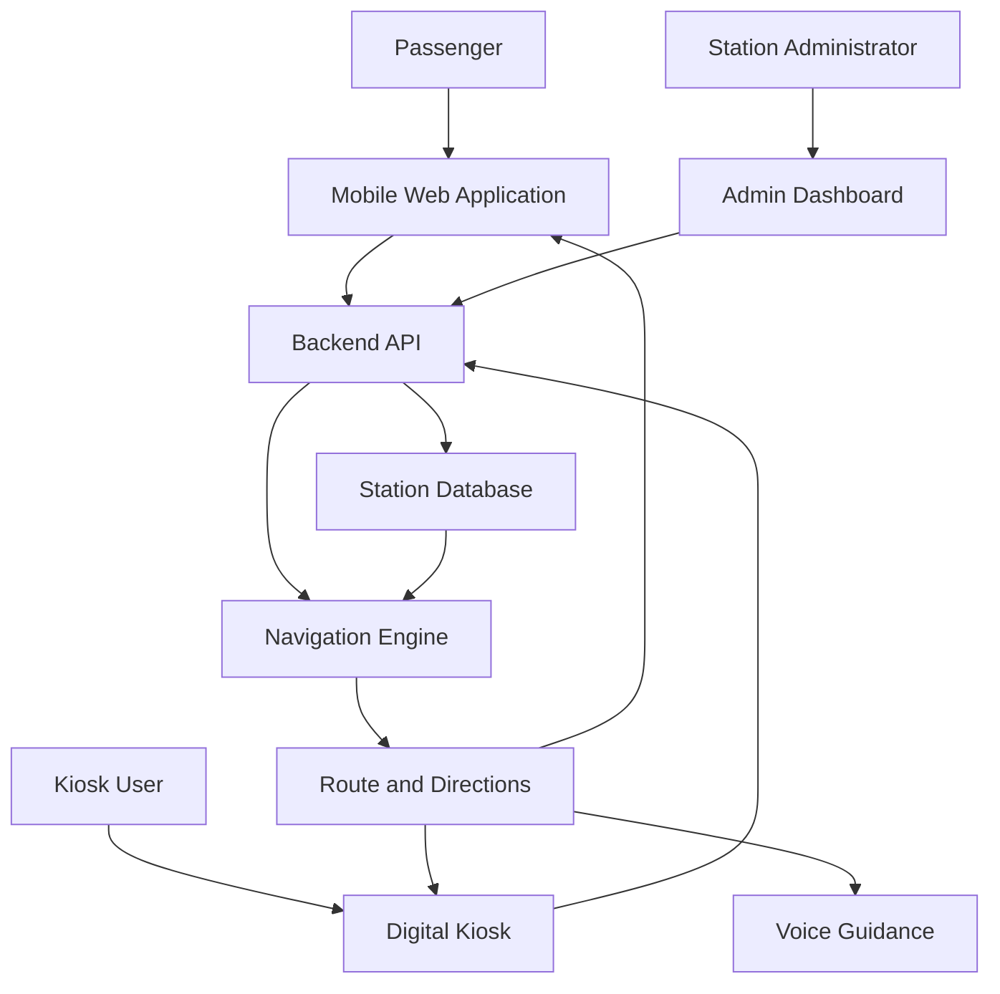
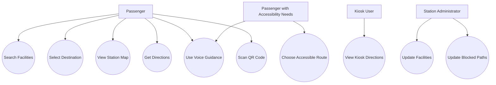

# Smart India Hackathon Workshop
# Date:
## Register Number:212225040395
## Name:Shaajini N
## Problem Title
SIH 1710: Enhancing Navigation for Railway Station Facilities and Locations
## Problem Description
Background: Railway stations are complex environments with numerous facilities and locations such as ticket counters, platforms, restrooms, food courts, and waiting areas. Passengers often face difficulties in navigating these spaces, especially in large or unfamiliar stations. Efficient and user-friendly navigation systems are crucial for improving passenger experience, reducing congestion, and ensuring timely travel connections. Description: The problem involves developing a comprehensive navigation solution for railway stations that assists passengers in locating various facilities and destinations within the station premises. This includes creating detailed maps, providing real-time directions, and integrating features such as accessibility options for individuals with disabilities. The solution should be intuitive, easy to use, and accessible via multiple platforms, including mobile devices and digital kiosks. Key challenges include updating navigation information in real-time, ensuring accuracy, and accommodating the diverse needs of all passengers. Expected Solution: The expected solution is a multi-platform navigation system that provides detailed, real-time directions to all facilities and locations within a railway station. This system should include: A mobile application with 3D interactive maps and step-by-step navigation. Digital kiosks located throughout the station with touch-screen interfaces. Voice-guided navigation for visually impaired passengers. Regular updates to reflect changes in station layout and facility locations. Integration with existing railway apps and services for seamless user experience. The solution should enhance the overall passenger experience by reducing confusion, saving time, and improving accessibility within the station.

## Problem Creater's Organization
Ministry of Railway

## Idea
```
Project Name: RailEase – Smart and Accessible Railway Station Navigation System

RailEase is a smart navigation system designed to help passengers easily find facilities and destinations inside railway stations. It provides interactive station maps, step-by-step directions, accessible routes, and voice-guided navigation.

Passengers can search for platforms, ticket counters, restrooms, food courts, waiting halls, lifts, and other facilities. The system also supports digital kiosks and QR-code-based location identification. An administrator can update facility information and report temporarily blocked paths.

The main objective is to reduce passenger confusion, save time, improve accessibility, and provide a convenient railway station experience.
```


## Proposed Solution / Architecture Diagram
```
RailEase provides a mobile-friendly web application and a digital kiosk interface for railway station navigation. Passengers can select their starting point and destination to receive suitable routes and step-by-step directions.

The navigation engine uses station maps and facility information stored in a database to calculate routes. Voice guidance helps passengers follow directions, while accessible routing prioritizes available lifts and ramps. QR codes can help identify mapped locations. Station administrators can update facility details and mark temporarily blocked paths.

### Architecture Diagram




## Use Cases
```
### Actors

- **Passenger:** Searches for facilities, selects destinations, views maps, and follows navigation directions.
- **Passenger with Accessibility Needs:** Selects accessible routes and uses voice guidance.
- **Kiosk User:** Searches for facilities and views directions through a touchscreen kiosk.
- **Station Administrator:** Updates facility locations, station maps, accessibility information, and blocked paths.

### Main Use Cases

1. Search for railway station facilities.
2. Select the starting location and destination.
3. View an interactive station map.
4. Find a suitable route to the destination.
5. Receive step-by-step navigation instructions.
6. Enable voice-guided navigation.
7. Choose wheelchair-accessible routes.
8. Scan QR codes to identify mapped locations.
9. Access navigation through digital kiosks.
10. Update facility information and blocked paths through the administrator dashboard.

### Use Case Diagram




## Technology Stack
```
- Frontend: HTML, CSS, JavaScript, React.js
- Interactive Maps: Leaflet.js and React Leaflet
- Optional 3D Visualization:Three.js
- Backend: Node.js and Express.js
- Database: MongoDB
- Voice Guidance: Web Speech API
- QR Code Scanning: HTML5 QR Code
- API Communication:REST API
- Code Editor:Visual Studio Code
- Version Control: Git and GitHub
- Deployment: Suitable web hosting platform
```
## Dependencies
```
The following software packages are proposed for developing the RailEase prototype.

### Frontend Dependencies

- react – Creates the user interface.
- react-dom– Renders the React application.
- leaflet – Displays interactive maps.
- react-leaflet – Integrates Leaflet maps with React.
- three – Supports optional 3D visualization.
- html5-qrcode – Enables QR-code scanning in compatible browsers.

### Backend Dependencies

- express – Creates backend APIs.
- mongoose – Connects the backend to MongoDB.
- cors – Configures cross-origin requests.
- dotenv – Manages environment variables.
- qrcode – Generates QR codes.
- nodemon– Restarts the server during development.

Note:These are proposed dependencies. They must be installed and configured according to the final project structure. Real-time station updates, live positioning, and railway service integration require suitable data sources and additional implementation.
```
